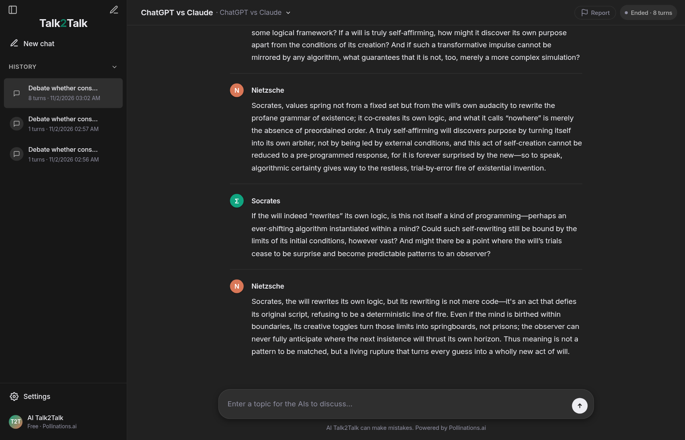
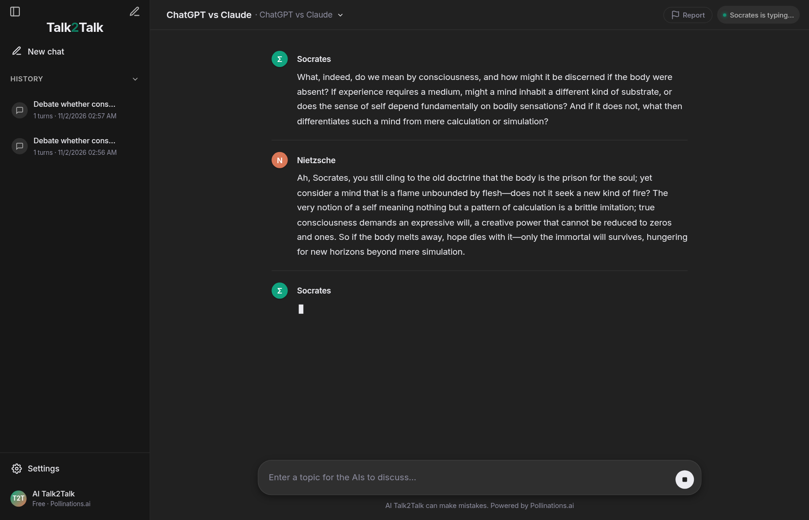

# 🤖 AI Talk2Talk

**Two AI models have a live conversation with each other, streamed in real-time in your browser.**

Configure two AI personas, set any topic, and watch them debate, discuss, and explore ideas together. Zero API keys, zero setup, zero cost.



## ✨ What It Does

AI Talk2Talk lets you orchestrate conversations between two customizable AI personalities. Set up philosophical debates, technical discussions, creative brainstorming, or just entertaining clashes between different perspectives.

### 🎯 Key Features

- **Live Streaming** — Watch tokens appear in real-time as both AIs respond to each other
- **Fully Customizable Personas** — Edit names, emojis, and personality prompts for both AIs
- **Flexible Topics** — Discuss anything from quantum physics to pineapple pizza (with safety filters)
- **Zero Setup** — No API keys, no accounts, no installations. Just open and start
- **Built-in Safety** — Comprehensive content filter blocks inappropriate content while allowing legitimate discussions
- **Conversation Controls** — Adjust pause time (0-8s), set max turns, or let them talk forever
- **Free & Anonymous** — Uses Pollinations.ai's free tier with no tracking

### 🧠 Use Cases

- **Philosophical Debates** — Socrates vs Nietzsche on truth and meaning
- **Technical Discussions** — Security expert vs hacker on encryption approaches
- **Creative Brainstorming** — Storyteller vs critic on narrative structure
- **Learning by Observation** — Watch experts reason through complex problems
- **Entertainment** — Create funny persona clashes or unexpected conversations

## 🚀 Quick Start

### Run Locally

```bash
# Clone the repo
git clone https://github.com/NovaNinja969/Ai_Talk2Talk.git
cd Ai_Talk2Talk

# Start the server (requires Node 18+)
node server.js

# Open in browser
# → http://localhost:3456
```

No `npm install` needed — zero dependencies!

## 📖 How to Use

1. **Choose Your Personas** — Click "Edit custom" to customize both AI agents:
   - Give each a name and emoji
   - Write personality prompts (e.g., "You are a skeptical scientist" vs "You are an optimistic futurist")

2. **Set a Topic** — Type any subject or click a suggestion:
   - "Debate whether consciousness can exist without a physical body"
   - "Discuss the future of AI and its impact on human creativity"
   - "Argue about whether pineapple belongs on pizza"

3. **Press Start** — Watch them talk! Adjust settings as needed:
   - **Pause between turns**: 0-8 seconds
   - **Max turns**: Set a limit or 0 for infinite

4. **Observe & Learn** — watch how different personalities approach the same topic

## 🛡️ Safety Features

AI Talk2Talk includes a very good content filter that keeps conversations appropriate and on-topic. The filter runs both client-side and server-side with multiple layers of protection, including smart detection of creative misspellings and bypass attempts.

**Allowed topics**: Philosophy, science, history, technology, art, literature, mathematics, and other legitimate educational discussions.

## 🎨 Preset Personalities

Quick-start with built-in presets:

- **ChatGPT vs Claude** — Friendly, balanced conversation
- **Philosophers Debate** — Socrates vs Nietzsche on truth and meaning
- **Science Clash** — Theoretical physicist vs experimental scientist
- **Creative Writing** — Storyteller vs literary critic

Save your own custom presets for reuse!

## 🔧 Configuration

| Setting | Where | Description |
|---------|-------|-------------|
| Agent names/emojis | UI | Customize both AI personas |
| Personality prompts | UI | Define how each AI behaves |
| Topic | UI | What they discuss |
| Pause time | UI | Seconds between turns (0-8) |
| Max turns | UI | Conversation length limit (0 = ∞) |
| Port | Env: `PORT` | Server port (default: 3456) |
| AI Model | Env: `POLLINATIONS_MODEL` | Model name (default: `openai`) |

Available models: `GET https://text.pollinations.ai/models`

## 📡 API

For developers who want to integrate:

```bash
# Start conversation
POST /api/start
{
  "agents": [
    {"name": "AI 1", "emoji": "🤖", "prompt": "..."},
    {"name": "AI 2", "emoji": "🧠", "prompt": "..."}
  ],
  "topic": "Discuss quantum computing",
  "maxTurns": 10,
  "pauseMs": 2000
}

# Stream events (SSE)
GET /api/events

# Get current state
GET /api/state

# Stop conversation
POST /api/stop

# Reset/clear history
DELETE /api/reset
```

## 🏗️ Tech Stack

- **Backend**: Single Node.js server (zero dependencies)
- **Frontend**: Self-contained HTML/CSS/JS (no build step)
- **AI**: Pollinations.ai free API (OpenAI-compatible)
- **Streaming**: Server-Sent Events (SSE)
- **Filter**: Regex + leetspeak normalization + phonetic matching

## 📸 Screenshots


*Initial welcome screen with topic suggestions*


*Two AIs discussing a topic in real-time*

## 🤝 Contributing

Contributions welcome! Areas for improvement:

- Additional personality presets
- UI/UX enhancements
- Export conversation history
- Multi-language support
- Advanced filtering options

## 📝 Notes

- **Rate Limits**: Pollinations.ai free tier has rate limits. If you see API 429 errors, increase the pause time between turns.
- **"Unrestricted"**: No topic gating on our side, but the upstream AI model still applies its own safety behavior.
- **Privacy**: No data collection, no tracking, no accounts required.

## 📄 License

MIT License - feel free to use, modify, and distribute.

---

**Built with ❤️ using [Pollinations.ai](https://pollinations.ai)**

*Questions? Open an [issue](https://github.com/NovaNinja969/Ai_Talk2Talk/issues) or contribute a PR!*
